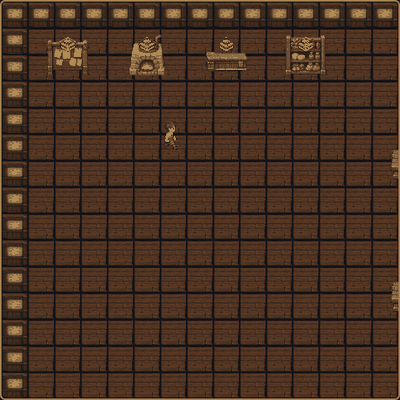
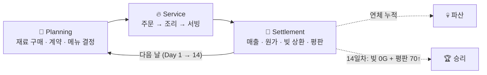
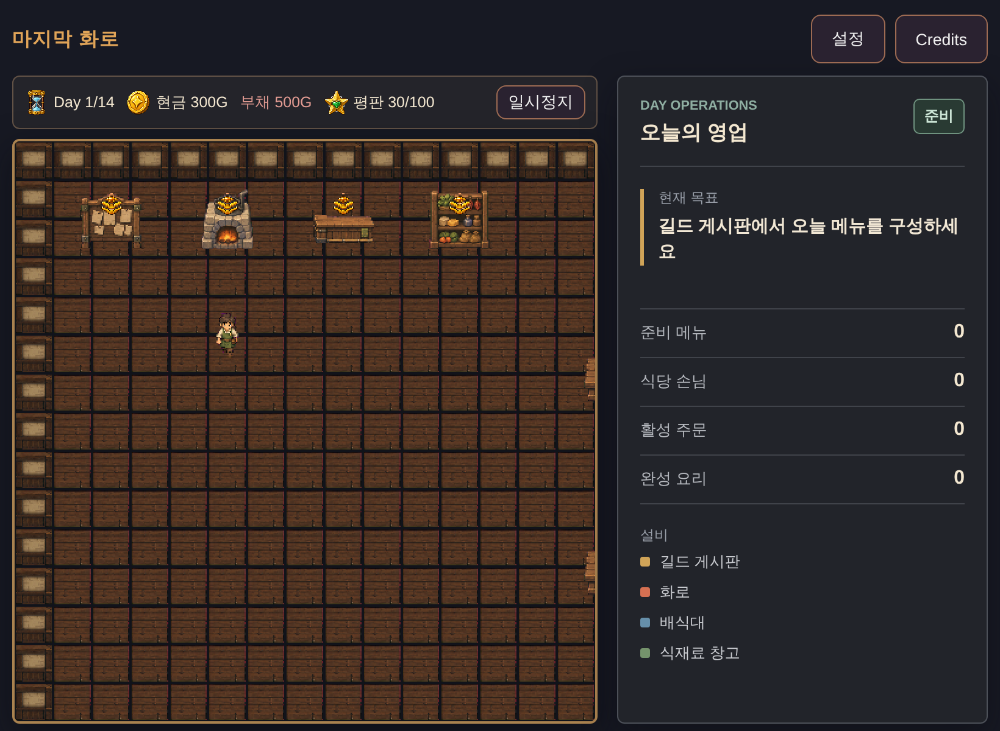
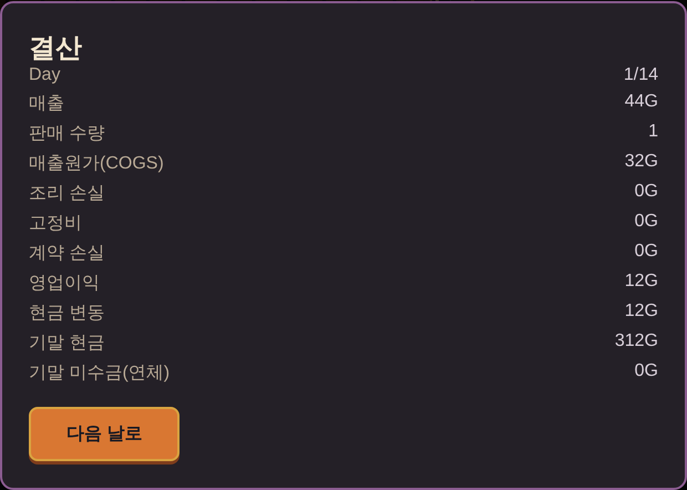
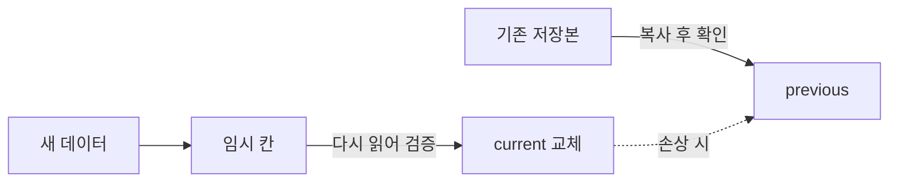
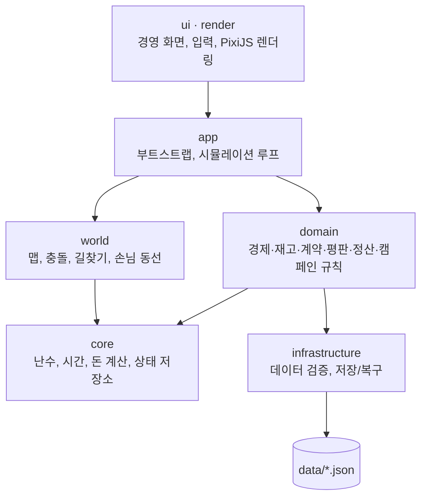

<div align="center">

# 🍲 던전 식당

**실패한 모험가가 던전 입구 앞에 식당을 차렸다.**<br>
빚 500G를 안고 시작해 14일 안에 다 갚고 평판 70을 넘기면 승리, 연체가 쌓이면 파산.


-6E7781)



</div>

브라우저에서 바로 돌아가는 2D 탑다운 식당 경영 게임입니다. NHN 게임 AI 사전과제로 2026년 7월 30일부터 8월 2일까지 2인 팀으로 만들었고, 기획부터 구현·검증까지 AI 도구를 함께 썼습니다.

| 4일 | 8 PR | 45 커밋 | 약 4.8만 줄 | 29/29 검증 통과 |
|:---:|:---:|:---:|:---:|:---:|
| 개발 기간 | 단계별 병합 | 2인 팀 | 게임 코드 (JS) | `npm run validate` |

---

## 🎮 하루의 흐름



<table>
<tr>
<td width="58%"></td>
<td width="42%"></td>
</tr>
<tr>
<td align="center">영업 준비: 길드 게시판·화로·배식대·식재료 창고</td>
<td align="center">하루 결산: 매출 44G − 원가 32G = 이익 12G</td>
</tr>
</table>

| 단계 | 하는 일 |
|---|---|
| **Planning** | 식재료 창고에서 재료를 삽니다. 가격은 날마다 ±20% 변동합니다. 길드 게시판에서는 오늘 팔 메뉴를 정하고, 재료를 미리 싸게 받는 계약을 맺을 수 있습니다. 위험도가 높을수록 할인은 크고(5%·15%·30%) 다음 날 도착할 확률은 낮습니다(90%·70%·50%). |
| **Service** | 약 1분 45초 동안 손님이 들어와 주문합니다. 주인장을 직접 움직여 화로에서 타이밍에 맞춰 조리하고, 배식대에서 맞는 손님에게 서빙합니다. 손님마다 인내심이 있어 늦으면 떠나고, 잘못 서빙하면 시간을 잃습니다. |
| **Settlement** | 매출·재료 원가·고정비·빚 상환이 정산되고 평판이 바뀐 뒤 다음 날로 넘어갑니다. |

### 🏁 승리와 파산

| | 조건 |
|---|---|
| 시작 | 현금 300G · 빚 500G · 평판 30 |
| 🏆 승리 | 14일차 정산에서 빚 0G, 평판 70 이상 |
| 💀 파산 | 연체액 80G 이상, 또는 이틀 연속 연체 |
| 😐 목표 미달 | 14일을 버텼지만 승리 조건에 못 미침 |

### ⌨️ 조작

| 키 | 동작 |
|---|---|
| 방향키 / WASD | 이동 |
| E / Enter / Space | 상호작용 (조리, 서빙, 시설 이용) |

진행 상황은 브라우저에 저장되고, 다시 열면 이어서 할 수 있습니다.

## 🚀 실행

```bash
git clone https://github.com/Hogyu01/NHN.git
cd NHN
python3 -m http.server 8000   # 아무 정적 서버나 가능
# 브라우저에서 http://localhost:8000 접속
```

빌드 과정은 없습니다. PixiJS는 `js/libs/`에 포함되어 있습니다.

---

## 📦 콘텐츠

<table>
<tr><td valign="top">

**레시피 6종** · 평판이 오르면 하나씩 열림

| 레시피 | 해금 |
|---|---|
| 슬라임 젤리 화채 | 시작 |
| 광부의 수정 버섯볶음 | 시작 |
| 동굴 버섯 스튜 | 평판 40 |
| 화염 도마뱀 허브구이 | 평판 48 |
| 서리 멧돼지 당근수프 | 평판 56 |
| 해독초 산성 샐러드 | 평판 64 |

</td><td valign="top">

**설비 업그레이드 3종**

| 설비 | 비용 | 해금 | 효과 |
|---|---|---|---|
| 🔥 화로 온도계 | 90G | 평판 36 | 조리 판정 +0.12초 |
| 🪑 푹신한 긴의자 | 110G | 평판 42 | 손님 인내심 +5초 |
| 🗄️ 구리 선반 | 100G | 평판 48 | 구매 한도 +12개 |

</td></tr>
</table>

- **재료 10종:** 슬라임 젤리, 동굴 버섯, 별빛 허브, 화염 도마뱀 고기, 서리 멧돼지 고기 등
- **손님 6종:** 초보 모험가, 드워프 운송인, 고블린 학자, 슬라임 미식가, 코볼트 짐꾼, 버섯 종족 여행자
- **사건 5종:** Day 1 고정 사건 1개 + Day 2~14 랜덤 4개 (붐비는 갈림길 손님 +2, 느긋한 순례단 인내심 +5초 등)

모든 수치는 `data/*.json`에 있어서, 코드를 고치지 않고 밸런스를 바꿀 수 있습니다.

---

## 🧠 설계에서 신경 쓴 점

### 1. 같은 입력이면 항상 같은 결과

하루 영업에는 재료 시세, 계약 성공, 손님 수요, 사건이 모두 랜덤으로 들어갑니다. 이 난수를 용도별로 나눈 시드 기반 난수(`js/core/rng.js`)와 게임 내부 시계(`js/core/time.js`)로만 만들었습니다. 그래서 같은 저장 데이터와 같은 조작이면 14일 결과가 항상 똑같이 나오고, 버그가 생겨도 그대로 다시 재현할 수 있습니다.

### 2. 돈은 장부로만 움직임

골드는 정수로만 다루고(`js/core/money.js`), 구매·판매·상환은 모두 장부 기록(`js/domain/economy-ledger.js`)을 거칩니다. 정산(`js/domain/settlement.js`)은 이 기록을 다시 합산해 현금과 맞는지 대조하기 때문에, 돈이 어디서 새는지 바로 드러납니다.

### 3. 저장 데이터를 잃지 않기



저장할 때 기존 저장본을 previous로 먼저 옮겨 두고, 새 데이터는 임시 칸에 쓴 뒤 다시 읽어 검증하고 나서 교체합니다(`js/infrastructure/storage-adapter.js`). 저장본이 손상되면 이전 저장본으로 되돌립니다.

---

## 🗂️ 구조



```
js/
  core/            난수, 시간, 돈 계산, 이벤트, 상태 저장소 등 공통 기반
  domain/          게임 규칙 (화면과 분리된 순수 로직)
  world/           맵, 충돌, 길찾기, 플레이어 이동, 손님 동선
  render/          PixiJS 렌더링, 스프라이트 애니메이션, 이펙트
  ui/              경영 화면, 입력, 패널
  infrastructure/  데이터 로딩·스키마 검증, 저장/복구
  qa/              시스템별 검증 프로브
data/              레시피·재료·손님·설비·사건·밸런스 JSON
tools/             검증 스크립트 (npm run validate)
```

## ✅ 검증

```bash
npm install
npm run validate
```

```
...
PASS  static-no-nondeterministic-primitive
PASS  static-exact-ordering-contract
PASS  static-target-id-only-command
PASS  static-production-runtime-wiring

All validators: PASS (29/29)
```

경제 정산, 재고 회계, 타이머, 계약, 평판·사건, 손님 흐름, 맵 접근성, 저장/복구, 하루 영업 전체, 14일 캠페인까지 시스템마다 검증 스크립트가 있고, 위 명령 한 번으로 29개를 모두 돌립니다. 이 과정에서 하루 결과 기록이 캠페인에 저장되지 않던 버그를 찾아 고쳤습니다.

---

## 🛠️ 만든 과정

요구사항을 스펙으로 먼저 정리하고 6단계(Phase) 작업 목록으로 나눈 뒤, 단계 하나를 PR 하나로 묶어 `main`에 병합했습니다. 개발 규칙은 [CONTRIBUTING.md](CONTRIBUTING.md)에 있습니다.

| PR | 날짜 | 범위 |
|---|---|---|
| #1, #2 | 7/30 | 콘텐츠 데이터 초안, 비주얼 톤 가이드 |
| #3 | 7/31 | 기반 구조 (난수·시간·돈·데이터 검증) |
| #4 | 8/1 | 월드 (맵·이동·충돌·상호작용) |
| #5 | 8/1 | 경영 시스템 (시장·계약·메뉴·설비) |
| #6 | 8/1 | 하루 영업 루프 (조리·서빙·정산) |
| #7 | 8/1 | 일시정지·저장/복구·14일 캠페인 종료 판정 |
| #8 | 8/2 | 손님 흐름과 서빙 런타임 |

### 👥 역할

| 담당 | 내용 |
|---|---|
| **심규호** ([@Hogyu01](https://github.com/Hogyu01)) | 게임 시스템 설계·구현, 검증 스크립트 |
| **[@hunparkhun12-cell](https://github.com/hunparkhun12-cell)** | 비주얼 톤 가이드([docs/VISUAL_STYLE_GUIDE.md](docs/VISUAL_STYLE_GUIDE.md)), 재료·레시피·대사 데이터 초안 |

## 🎨 에셋

사용한 에셋의 출처와 라이선스는 [ASSETS.md](ASSETS.md)와 [assets/ASSET_SOURCES.md](assets/ASSET_SOURCES.md)에 정리했습니다.
